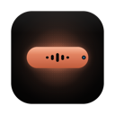

<div align="center">
  
  <h3 align="center">Vibe Notch (previously Claude Island)</h3>
  <p align="center">
    A macOS menu bar app that brings Dynamic Island-style notifications to your coding agents — Claude Code, WorkBuddy, and OpenCode.
    <br />
    <br />
    <a href="https://github.com/farouqaldori/vibe-notch/releases/latest" target="_blank" rel="noopener noreferrer">
      
    </a>
    <a href="#" target="_blank" rel="noopener noreferrer">
      
    </a>
  </p>
</div>

> **🟢 Actively maintained**
>
> Launched v1.2 in December 2025, then took a 4-month break. v1.3 (April 2026) works through the backlog of contributor PRs and bug reports and kicks off a regular cadence again. Open PRs and issues are being reviewed — thanks for your patience.

## Features

- **Notch UI** — Animated overlay that expands from the MacBook notch, with a built-in settings menu right inside the panel.
- **Multi-Agent Monitoring** — Track live sessions from Claude Code, WorkBuddy, and OpenCode side by side, each tagged with a short badge (`WB`, `OC`).
- **Live Session Monitoring** — See every running agent session, its status (processing / waiting for input / completed), model, and working directory in real time.
- **Permission Approvals** — Approve or deny Claude Code tool executions directly from the notch — no need to switch back to the terminal.
- **Chat History** — View the full conversation with markdown rendering for Claude Code sessions.
- **Shell Panel** — A read-only view of the shell commands your agents have run (command, output, status), scoped per session or across all sessions.
- **Monitor Panel** — Track background / detached tasks agents spawn, with a notch bounce and sound when a task finishes.
- **Multi-Display** — Automatically prefer the built-in display, or pin the notch to a specific screen; works correctly with displays of different sizes and arrangements.
- **Auto-Setup** — Claude Code hooks install automatically on first launch.
- **Polished Details** — Launch at login, selectable completion sounds, and built-in auto-updates via Sparkle.

## Requirements

- macOS 15.6+
- At least one supported coding agent:
  - **Claude Code** CLI (full support: hooks, permissions, chat history)
  - **WorkBuddy** (session monitoring)
  - **OpenCode** (session monitoring)

## Install

Download the latest release, or build from source:

```bash
xcodebuild -scheme VibeNotch -configuration Release build
```

## How It Works

Each supported agent is an independent provider unit. Vibe Notch detects their activity using whatever data source each tool exposes, then normalizes everything into a single session model that the notch UI renders.

| Agent | Detection | Capabilities |
|-------|-----------|--------------|
| **Claude Code** | Hooks installed into `~/.claude/hooks/` push state over a Unix socket | Sessions, permission approvals, chat history, shell & background tasks |
| **WorkBuddy** | Polls `~/.workbuddy-ai/sessions/*.json` heartbeats and reads `~/.workbuddy-ai/workbuddy.db` (read-only) | Sessions, shell & background tasks |
| **OpenCode** | Polls `~/.local/share/opencode/opencode.db` (read-only; override with `OPENCODE_DATA_DIR`) | Sessions, shell & background tasks |

When Claude Code needs permission to run a tool, the notch expands with approve/deny buttons. Polled agents (WorkBuddy, OpenCode) are discovered every few seconds and their status is derived from the agent's own database and transcript activity.

## Analytics

Vibe Notch uses Mixpanel to collect anonymous usage data:

- **App Launched** — App version, build number, macOS version
- **Session Started** — When a new agent session is detected

No personal data or conversation content is collected.

## License

Apache 2.0
