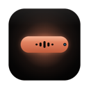

<div align="center">
  
  <h3 align="center">Vibe Notch（前身为 Claude Island）</h3>
  <p align="center">
    一款 macOS 菜单栏应用，为你的编程助手带来「灵动岛」风格的通知 —— 支持 Claude Code、WorkBuddy、OpenCode 和 LM Studio。
    <br />
    <br />
    <a href="https://github.com/farouqaldori/vibe-notch/releases/latest" target="_blank" rel="noopener noreferrer">
      
    </a>
    <a href="#" target="_blank" rel="noopener noreferrer">
      
    </a>
  </p>
</div>

> **🟢 持续维护中**
>
> 2025 年 12 月发布 v1.2 后暂停了约 4 个月。v1.3（2026 年 4 月）集中处理了贡献者提交 PR 与问题反馈的积压，并恢复了稳定的更新节奏。目前正在审查所有开放的 PR 与 issue —— 感谢大家的耐心等待。

## 功能特性

- **灵动岛 UI** — 从 MacBook 刘海处展开的动画浮层，面板内直接内置设置菜单。点击刘海即可展开；鼠标悬停仅显示轻微阴影提示，**不会**自动展开。
- **多助手监控** — 并排追踪 Claude Code、WorkBuddy、OpenCode 和 LM Studio 的实时会话，每个会话都带有简短标识徽章（`WB`、`OC`、`LM`）。
- **实时会话监控** — 实时查看每个正在运行的助手会话、其状态（处理中 / 等待输入 / 已完成）、所用模型和工作目录。
- **权限审批** — 直接在灵动岛中批准或拒绝 Claude Code 的工具调用 —— 无需切回终端。
- **跳转到终端** — 每个会话都有一个跳转按钮，点击即可把运行该助手的窗口置前。宿主应用由进程链解析(因此 Paseo 这类 Electron helper 会正确归到主 app，WorkBuddy / LM Studio 这类 GUI 助手也能跳转)。Terminal.app 与 iTerm2 按 TTY 精确匹配，WezTerm 通过其 CLI 按 pane(TTY / 工作目录)精确匹配，其余则激活宿主应用并按窗口标题匹配项目后抬窗；tmux + yabai 仍保留原有的精确 pane 切换。
- **聊天历史** — 查看完整对话，Claude Code 会话支持 Markdown 渲染。
- **Shell 面板** — 只读查看助手运行过的 shell 命令（命令、输出、状态），可按会话或跨所有会话查看。
- **监控面板** — 追踪助手启动的后台 / 分离任务，任务完成时灵动岛会弹跳并播放提示音。
- **多显示器** — 自动优先使用内置屏幕，也可将灵动岛固定到指定屏幕；在不同尺寸和排布的显示器上均能正确工作。
- **自动配置** — 首次启动时自动安装 Claude Code 的 hooks。
- **精致细节** — 登录自启动、可选完成提示音，以及基于 Sparkle 的内置自动更新。

## 系统要求

- macOS 15.6 及以上
- 至少安装一个受支持的编程助手或本地模型服务：
  - **Claude Code** CLI（完整支持：hooks、权限、聊天历史）
  - **WorkBuddy**（会话监控）
  - **OpenCode**（会话监控）
  - **LM Studio** 0.4+ 且安装了 `lms` CLI（本地 API 请求监控）

## 安装

下载最新发布版本，或从源码构建：

```bash
xcodebuild -scheme VibeNotch -configuration Release build
```

## 工作原理

每个受支持的助手都是一个独立的 provider 单元。Vibe Notch 借助各工具暴露的数据源来检测它们的活动，然后将所有数据归一化为统一的会话模型，由灵动岛 UI 渲染出来。

| 助手 | 检测方式 | 支持能力 |
|-------|-----------|--------------|
| **Claude Code** | 安装到 `~/.claude/hooks/` 的 hooks 通过 Unix 套接字推送状态 | 会话、权限审批、聊天历史、shell 与后台任务 |
| **WorkBuddy** | 轮询 `~/.workbuddy-ai/sessions/*.json` 心跳，并读取 `~/.workbuddy-ai/workbuddy.db`（只读） | 会话、shell 与后台任务 |
| **OpenCode** | 轮询 `~/.local/share/opencode/opencode.db`（只读；可用 `OPENCODE_DATA_DIR` 覆盖） | 会话、shell 与后台任务 |
| **LM Studio** | 跟踪 `lms log stream --json`（模型日志 + server 日志），无需 API token 或反向代理 | 本地 API 请求、推理开始/结束、模型名 |

当 Claude Code 需要权限运行某个工具时，灵动岛会展开显示「批准 / 拒绝」按钮。被轮询的助手（WorkBuddy、OpenCode）每隔几秒被发现一次，其状态根据助手自身的数据库与转录活动推导得出。

LM Studio 通过官方 `lms` CLI 的日志流监听：所有到达本地 API 服务（默认 `127.0.0.1:1234`）的请求，以及推理开始/结束事件，会聚合为一个会话。CLI 走自己的内部通道鉴权，因此**不需要 API token、反向代理，也不用修改 LM Studio 的服务设置**。实现只读取事件类型、时间戳、模型标识和请求方法/路径 —— 提示词与回复正文既不会被读取也不会写入日志。由于 LM Studio 不暴露会话 ID 和工作目录，聊天历史、权限审批与「跳转到终端」对它不可用。未安装 `lms` 时该 provider 完全不启动；CLI 不在标准位置可用 `LMS_CLI_PATH` 指定路径。

## 脚本

`scripts/` 文件夹中包含用于构建、签名和发布应用的辅助脚本。所有脚本都从项目根目录运行，并假定你已安装 Xcode 命令行工具及所需的 CLI。

> **注意：** 仓库根目录下的 `release-build.sh` 只是对 `xcodebuild -scheme VibeNotch -configuration Release build` 的一行薄封装。它只执行本地编译（产物位于 Xcode 的 DerivedData 中），**不会**生成可分发的 `.app`/DMG。若要走完整的发布流程（归档、公证、打包、发布），请改用下方的 `scripts/` 辅助脚本。

### `build.sh` — 构建发布归档

使用 `xcodebuild` 归档并导出一个已签名、已加固的 `Vibe Notch.app`。

```bash
./scripts/build.sh
```

- 清理并重建 `build/`，随后运行 `xcodebuild archive`（Release 配置、加固运行时、自动签名）。
- 使用生成的 `ExportOptions.plist`（`developer-id` 方式）将归档导出到 `build/export/Vibe Notch.app`。
- 需要 `xcpretty`（可选 —— 缺失时回退为原始输出）。
- **产出：** `build/export/Vibe Notch.app`

### `generate-keys.sh` — 生成 Sparkle EdDSA 密钥

生成用于签署 Sparkle 自动更新源的 EdDSA 密钥对。**只需运行一次，并妥善保管私钥。**

```bash
./scripts/generate-keys.sh
```

- 定位 Sparkle 的 `generate_keys` 工具（来自 Xcode 的 SPM 构建或手动安装）。
- 将私钥写入 `.sparkle-keys/eddsa_private_key`（权限 `600`），并在你的 macOS 钥匙串中保存一份副本。
- 打印**公钥** —— 将其作为 `SUPublicEDKey` 添加到 `Info.plist` 中。
- 自动将 `.sparkle-keys/` 加入 `.gitignore`，确保密钥不会被提交。
- 重新生成密钥会导致已有用户无法更新，因此当密钥已存在时会提示确认。

### `create-release.sh` — 公证、打包与发布

完整的发布流水线：公证应用、制作 DMG、为 Sparkle 签名、生成 appcast、发布 GitHub Release，并更新网站。

```bash
./scripts/create-release.sh
```

执行步骤：

1. **公证** 应用（通过 `notarytool`，钥匙串配置文件为 `VibeNotch`）。若未配置凭据，会提示是否跳过。
2. **制作 DMG** —— 优先使用 `create-dmg`，否则回退到 `hdiutil`。
3. **公证** DMG。
4. **为 Sparkle 签名** 并生成 `appcast.xml`（需要 `generate-keys.sh` 的产出，以及此前 Xcode 构建中的 Sparkle 工具）。
5. **创建 GitHub Release**（通过 `gh`），标签为 `v<VERSION>` 并上传 DMG。
6. **更新网站**（通过 `wrangler` 部署到 Cloudflare Pages）及 `appcast.xml`。

前置条件：

- 先运行 `build.sh`，确保 `build/export/Vibe Notch.app` 已存在。
- 先运行 `generate-keys.sh` 以进行 Sparkle 签名。
- 配置公证所需的钥匙串配置文件：
  ```bash
  xcrun notarytool store-credentials "VibeNotch" \
      --apple-id "your@email.com" \
      --team-id "2DKS5U9LV4" \
      --password "xxxx-xxxx-xxxx-xxxx"
  ```
- `gh` CLI（用于 GitHub Release）与 `wrangler`（用于网站部署）为可选但推荐安装。
- GitHub 仓库与网站路径在脚本顶部配置（`GITHUB_REPO`、`WEBSITE_DIR`）。

## 数据分析

Vibe Notch 使用 Mixpanel 收集匿名的用量数据：

- **App Launched（应用启动）** — 应用版本、构建号、macOS 版本
- **Session Started（会话开始）** — 检测到新的助手会话时

不会收集任何个人数据或对话内容。

## 许可证

Apache 2.0
